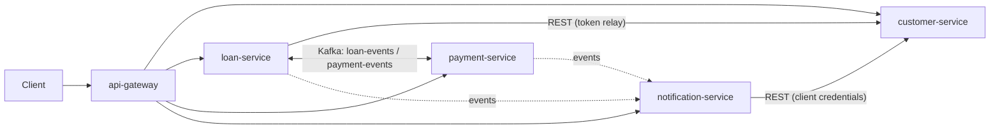

# Loan Management Platform

[](https://github.com/appledelhi99/loanmanagement/actions/workflows/ci.yml)

A production-style **Spring Boot microservices** portfolio project. It rebuilds the ideas of *Spring Microservices in Action, 2nd Edition* (Carnell & Huaylupo Sánchez) on a current, supported stack: **Java 25 LTS · Spring Boot 4.1 · Spring Cloud 2025.1 "Oakwood"**.

> **Status: Phase 2 of 8 — parent build, config-server and discovery-server written; waiting for the first GitHub Actions run.** Architecture (Phase 1) accepted on 2026-10-18.
>
> Payments are **simulated**. The platform never talks to a real bank.

## What it does

Customers sign in with Keycloak and apply for a loan. Loan officers review and approve or reject. An approved loan triggers a saga: payment-service pays out (simulated), loan-service records the result, notification-service emails everyone (to a local Mailpit inbox). Customers repay with an idempotency key against a locked ledger, so a retry never charges twice and nobody can overpay. Every step is traced across services.



## Documentation

| Document | What is inside |
|---|---|
| [01 Architecture overview](docs/architecture/01-architecture-overview.md) | Goals, C4 context + container diagrams, boundaries, data ownership, security, resilience, deployment views, ports |
| [02 Workflows](docs/architecture/02-workflows.md) | Sequence diagrams for the 10 required scenarios, failure catalogue, tracing path |
| [03 Technology inventory](docs/architecture/03-technology-inventory.md) | Every technology, where it is used and the problem it solves; what we left out and why |
| [04 Book → modern mapping](docs/architecture/04-book-to-modern-mapping.md) | Each book concept and its 2026 implementation |
| [05 Version compatibility matrix](docs/architecture/05-version-compatibility-matrix.md) | Verified versions with sources and dates |
| [06 Repository structure](docs/architecture/06-repository-structure.md) | Maven multi-module tree, package layout, module rules |
| [07 Trade-offs](docs/architecture/07-trade-offs.md) | The 8 required trade-off analyses |
| [08 Architecture review](docs/architecture/08-architecture-review.md) | Independent review: version checks, 32 prioritised findings, corrections applied |
| [ADRs](docs/adr/README.md) | 23 architecture decision records |
| [Implementation plan](docs/plan/implementation-plan.md) | Phases 2–8 with acceptance criteria, requirement checklist, risks |
| [Phase 2 report](docs/plan/phase-2-report.md) | What Phase 2 built, design decisions, commands, verification results |

## Stack at a glance

| Area | Choice |
|---|---|
| Language / framework | Java 25, Spring Boot 4.1, Spring Framework 7, Spring Cloud 2025.1 |
| Services | Spring MVC on virtual threads; gateway on Spring Cloud Gateway (WebFlux) |
| Service calls | Spring HTTP Service Clients + Spring Cloud LoadBalancer + Resilience4j |
| Data | PostgreSQL 18 (database per service, owner/app users), Flyway, Redis (product cache, rate limits) |
| Messaging | Apache Kafka 4 (KRaft), transactional outbox, idempotent consumers, payment executor, DLTs |
| Security | Keycloak 26, OAuth 2.0 / OIDC, JWT, roles + scopes, checks at gateway and services |
| Observability | Micrometer + OpenTelemetry → Jaeger, Prometheus, Grafana, Loki/Alloy, ECS JSON logs |
| Testing | JUnit Jupiter, Mockito, Testcontainers, Spring Cloud Contract (HTTP), golden-example event contracts, ArchUnit, E2E |
| Delivery | Docker, Compose, Helm, kind, Terraform, GitHub Actions (Jenkins optional), AWS EKS (optional) |

## Roadmap

| Phase | Scope | Status |
|---|---|---|
| 1 | Architecture, technology matrix, ADRs, plan, independent review | ✅ Accepted 2026-10-18 |
| 2 | Parent Maven build, config-server, discovery-server | 🟡 Code complete — first CI run pending |
| 3 | customer-service, loan-service, PostgreSQL, migrations, tests | ⏳ |
| 4 | Gateway, OAuth 2.0 / Keycloak, service-to-service security | ⏳ |
| 5 | Kafka, payment-service, notification-service, outbox, saga, idempotency | ⏳ |
| 6 | Resilience, caching, tracing, metrics, dashboards, logging | ⏳ |
| 7 | Compose, CI/CD, Helm, Terraform, optional AWS | ⏳ |
| 8 | Full verification, final docs | ⏳ |

## Getting started

What you need: **JDK 25** (Eclipse Temurin) and **Docker** with Compose v2. Maven is not needed: `./mvnw` downloads Maven 3.9.11 the first time.

```bash
git clone https://github.com/appledelhi99/loanmanagement.git && cd loanmanagement

# Build and run every test (unit + integration + rules)
./mvnw -B verify

# Build the images and start config-server + discovery-server
docker compose -f deploy/compose/compose.yaml --profile core up -d --build --wait

# Config for any service and profile (most specific source first)
curl -s http://localhost:8888/loan-service/docker

# Eureka dashboard
open http://localhost:8761        # or visit it in a browser

# Stop everything
docker compose -f deploy/compose/compose.yaml --profile core down
```

| Component | API port | Management port (health, info) |
|---|---|---|
| config-server | 8888 | 9888 |
| discovery-server | 8761 | 9761 |

Management ports stay inside the Docker network; Compose checks them with the `healthcheck` script baked into each image.

Windows: `mvnw` is a POSIX shell script. Run it from Git Bash or WSL, or create the official Windows wrapper once with `mvn -N wrapper:wrapper -Dmaven=3.9.11`.

Every push and pull request runs [`.github/workflows/ci.yml`](.github/workflows/ci.yml): the Maven build with all tests, then a Docker Compose smoke test.

## Licence

To be chosen by the owner before the repository is made public (MIT or Apache-2.0 are common for portfolios).
