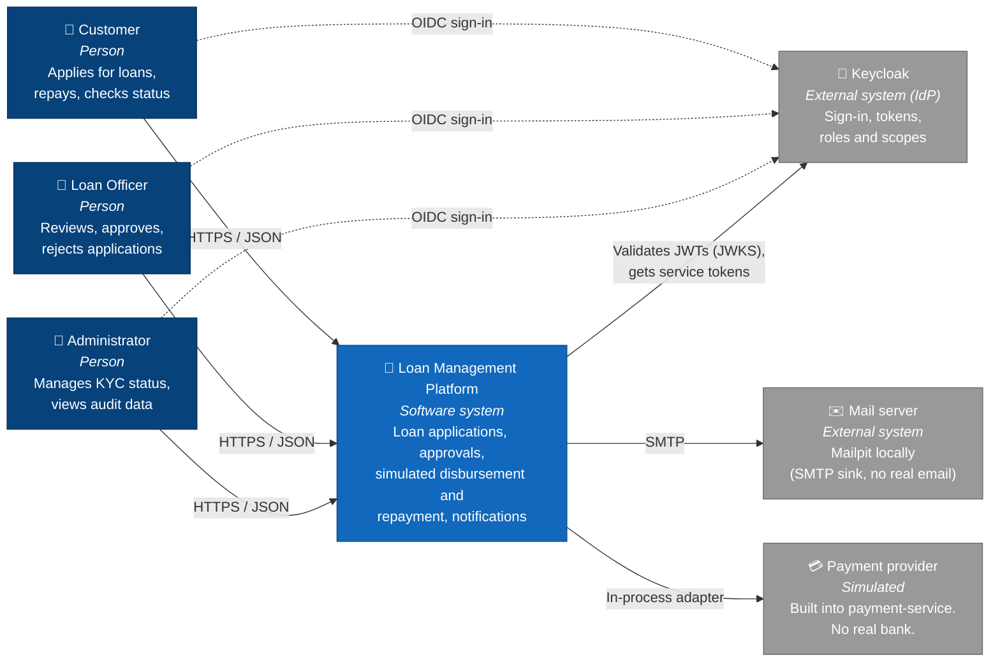
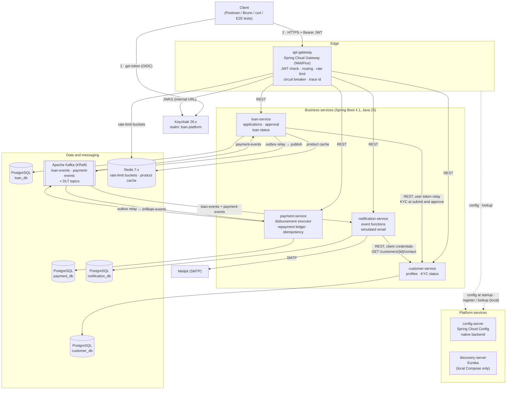
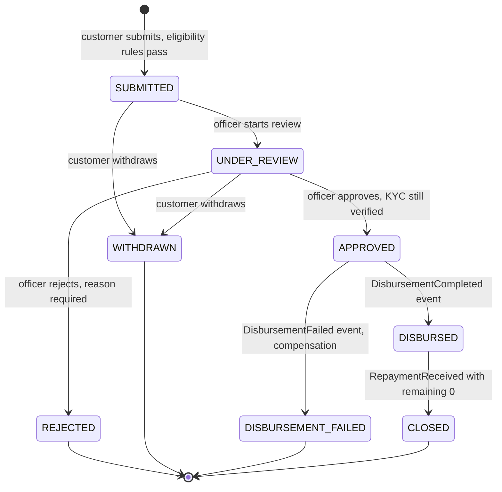
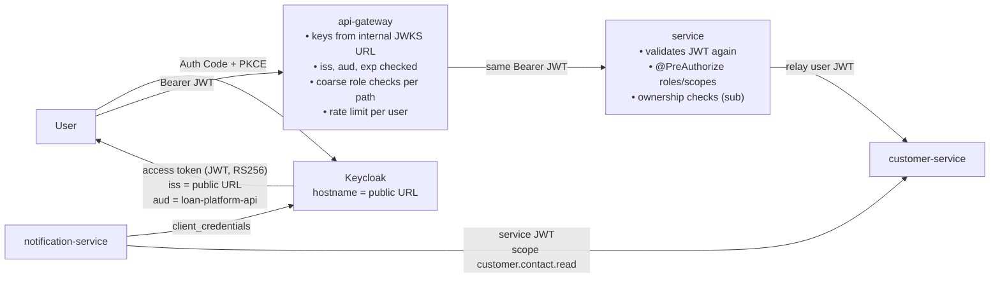
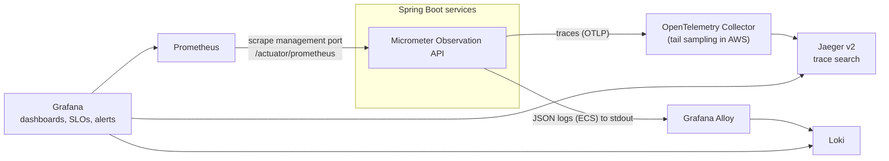
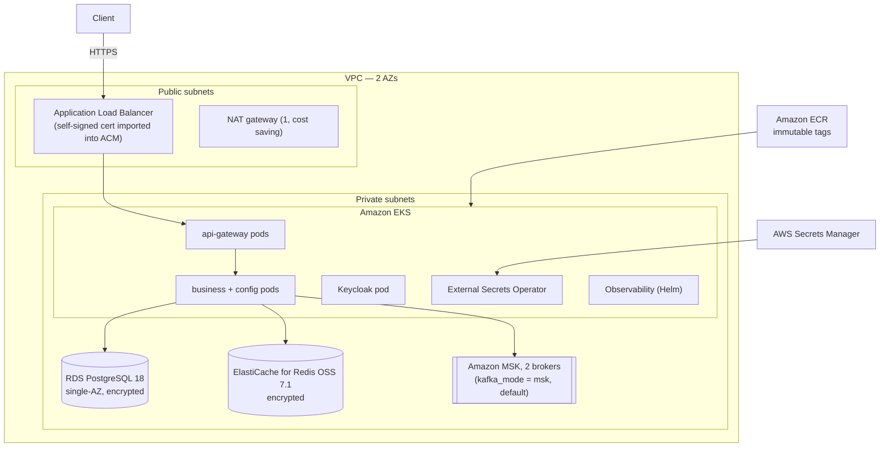

# 01 — Architecture Overview

| | |
|---|---|
| Status | **Accepted — confirmed by the owner on 2026-10-18** |
| Date | 2026-10-16 (revised after the [architecture review](08-architecture-review.md)) |
| Scope | Loan Management Platform (LMP) — portfolio project |
| Related | [Workflows](02-workflows.md) · [Technology inventory](03-technology-inventory.md) · [Version matrix](05-version-compatibility-matrix.md) · [Review](08-architecture-review.md) · [ADRs](../adr/README.md) · [Plan](../plan/implementation-plan.md) |

---

## 1. Goals

### 1.1 Business goals

| # | Goal | How the platform meets it |
|---|---|---|
| B1 | Customers apply for a loan online | Customer signs in (Keycloak), submits an application through the API gateway |
| B2 | Loan officers review and decide | Officer-only review, approve and reject actions with an audit trail |
| B3 | Approved loans are paid out | A saga moves money (simulated) and updates the loan status |
| B4 | Customers repay safely | Repayment API with an `Idempotency-Key` and a locked ledger, so a retry never charges twice and nobody can overpay |
| B5 | Customers are kept informed | Event-driven email notifications (simulated, captured by Mailpit) |

> **No real money moves.** The payment provider is a simulator inside `payment-service`. The platform never calls a real bank.

### 1.2 Quality goals

| Quality | Target | Mechanism |
|---|---|---|
| Independent deployability | Each service builds, tests and ships alone | Maven modules, own DB, own image, own Helm values |
| Reliability | No lost events, no double payments | Transactional outbox, idempotent consumers, Idempotency-Key, payment executor |
| Resilience | One slow service does not take others down | Timeouts, circuit breakers, bulkheads, bounded retries, rate limits |
| Security | Least privilege, no secrets in Git | OAuth 2.0 / OIDC, roles + scopes, checks at gateway **and** service, separate management port, network policies, secret managers |
| Observability | Any request can be traced end to end | Micrometer + OpenTelemetry traces, Prometheus metrics, JSON logs with trace IDs, SLOs |
| Reproducibility | One command to run locally, no AWS account needed | Docker Compose with profiles, documented commands |
| Cost control | AWS is optional and short-lived | Terraform `apply` for a demo, `destroy` after; single small environment |

### 1.3 Out of scope

Real KYC checks, credit bureau calls, daily interest accrual, amortisation schedules, penalties, refunds, multi-currency (all amounts are INR), a web UI (clients are Postman/Bruno/curl and the E2E test suite).

---

## 2. C4 Level 1 — System context

| Actor / system | Role in Keycloak | What they can do |
|---|---|---|
| Customer | `CUSTOMER` | Create own profile, apply, withdraw own application, repay own loan, read own data |
| Loan officer | `LOAN_OFFICER` | Read customers and applications, start review, approve, reject, view payments |
| Administrator | `ADMIN` | Read everything an officer can, set KYC status, read notification audit log |
| Keycloak | — | Issues tokens. Owns users, roles, clients, scopes |
| Mailpit | — | Receives emails over SMTP and shows them in a web UI. Nothing leaves the laptop |

---

## 3. C4 Level 2 — Containers

> Every service reads its config from `config-server` at startup and, in Docker Compose, registers with `discovery-server` (Eureka). The two dotted arrows stand for those links from every service. Observability containers are shown in [section 10](#10-observability).

### 3.1 Container catalogue

| Container | Type | Main tech | Owns data | API port | Mgmt port | Mandatory? |
|---|---|---|---|---|---|---|
| `api-gateway` | Edge service | Spring Cloud Gateway Server WebFlux, OAuth2 Resource Server, Redis rate limiter | none (rate-limit buckets in Redis) | 8080 | 9080 | Yes |
| `config-server` | Platform | Spring Cloud Config Server (`native`) | `config-repo/` (mounted locally, baked into the image for clusters) | 8888 | 9888 | Yes |
| `discovery-server` | Platform | Spring Cloud Netflix Eureka Server | in-memory registry | 8761 | 9761 | Local Compose only ([ADR-0006](../adr/0006-service-discovery-eureka-locally-kubernetes-native-in-clusters.md)) |
| `customer-service` | Business (supporting) | Spring MVC, Data JPA | `customer_db` | 8081 | 9081 | Yes |
| `loan-service` | Business (core) | Spring MVC, Data JPA, HATEOAS, Spring Kafka, HTTP Service Client, Spring Cache | `loan_db` | 8082 | 9082 | Yes |
| `payment-service` | Business (core) | Spring MVC, Data JPA, Spring Kafka, Resilience4j, scheduled executor | `payment_db` | 8083 | 9083 | Yes |
| `notification-service` | Business (supporting) | Spring Cloud Stream (Kafka binder), Spring Cloud Function, Spring Mail, HTTP Service Client | `notification_db` | 8084 | 9084 | Yes |
| PostgreSQL 18 | Database | one server locally, **one database + two users (owner, app) per service** | — | 5432 | — | Yes |
| Apache Kafka 4.x (KRaft) | Broker | single broker locally, 3 partitions per topic | — | 9092 | — | Yes |
| Redis 7.x | Cache | matches ElastiCache for Redis OSS 7.1 | — | 6379 | — | Yes |
| Keycloak 26.x | Identity provider | realm `loan-platform`, own DB `keycloak_db` | — | 8180 | (internal) | Yes |
| Mailpit | SMTP sink | catches all emails | — | 1025 / UI 8025 | — | Yes (local) |
| Observability stack | Tools | OTel Collector, Jaeger, Prometheus, Grafana, Loki, Alloy | — | see §12 | — | Optional profile |

Every application uses the **same ports in every environment** (IDE, Compose, Kubernetes). Actuator lives **only** on the management port ([ADR-0023](../adr/0023-separate-management-port-and-network-policies.md)).

---

## 4. Service boundaries

Each service is one **bounded context**. A service owns its data and its rules. Other services see it only through its API or its events.

| Service | Owns (source of truth) | Does **not** do | Style |
|---|---|---|---|
| customer-service | Customer profile, contact details, KYC status, link to Keycloak `sub` | Loans, payments, emails | Layered (supporting subdomain, mostly CRUD) |
| loan-service | Loan products, applications, decisions, loan terms (principal, tenure, EMI, total payable), loan status | Moving money, the repayment ledger, sending email, customer master data | **Hexagonal** (core subdomain) |
| payment-service | Payments (disbursement, repayment), **repayment ledger** (total payable, repaid, reserved), idempotency keys, provider calls | Loan decisions, customer data | **Hexagonal** (core subdomain, money) |
| notification-service | Notification log (what was sent, when, masked recipient) | Business decisions | Layered + functions |
| api-gateway | Routing rules, edge security, rate limits | Business rules | Config-driven |

See [ADR-0003](../adr/0003-service-boundaries-and-database-per-service.md).

---

## 5. Domain model summary

### 5.1 Loan application lifecycle (owned by loan-service)

### 5.2 Key business rules

| Rule | Where checked | Detail |
|---|---|---|
| R1 Customer must exist and KYC must be `VERIFIED` at submission | loan-service (calls customer-service with the user's token) | Else `422 KYC_NOT_VERIFIED` |
| R1b KYC must **still** be `VERIFIED` at approval | loan-service (calls customer-service with the officer's token) | Fail closed: customer-service down → `503`, no approval |
| R2 Amount and tenure within product limits | loan-service domain | e.g. Personal loan: ₹50,000–₹25,00,000, 12–60 months |
| R3 EMI ≤ 50% of declared monthly income | loan-service domain | `EMI = P·r·(1+r)^n / ((1+r)^n − 1)`, `BigDecimal`, `HALF_EVEN`, 2 decimals |
| R4 At most 2 open applications per customer | loan-service (DB query) | Open = `SUBMITTED`, `UNDER_REVIEW`, `APPROVED` |
| R5 Only `LOAN_OFFICER` may review, approve or reject | gateway (path) + service (`@PreAuthorize`) | Defence in depth |
| R6 Approver must not be the applicant | loan-service domain | Compare token `sub` with applicant `sub` |
| R7 Status changes follow the state machine | loan-service domain | Illegal move → `409 INVALID_STATE_TRANSITION` |
| R8 Concurrent decisions are rejected | JPA `@Version` | Second writer gets `409 CONCURRENT_MODIFICATION` |
| R9 One disbursement per loan | payment-service unique key (`loan_id`, `type = DISBURSEMENT`) | Duplicate events cannot pay twice |
| R10 Repayment needs `Idempotency-Key` | payment-service | Same key + same request → same response; same key + different request → `422 IDEMPOTENCY_KEY_REUSED` |
| R11 Repayment ≤ remaining amount, **no overpayment possible** | payment-service ledger, row lock | `SELECT … FOR UPDATE` on `loan_accounts`; `amount ≤ totalPayable − repaid − reserved`; else `422 AMOUNT_EXCEEDS_REMAINING` |

### 5.3 Payment lifecycle (owned by payment-service)

`PENDING → COMPLETED` or `PENDING → FAILED`. The Kafka listener only creates `PENDING` disbursements. The **payment executor** (a scheduled worker using `FOR UPDATE SKIP LOCKED`) makes the first provider call **and** every retry, with a budget (max 5 attempts within 15 minutes). Only a provider **decline** or an exhausted budget makes a payment `FAILED`. Repayments call the provider directly in the request (the customer waits); if the provider is slow, the request returns `202` and the executor finishes it. See [ADR-0012](../adr/0012-choreography-saga-for-loan-disbursement.md).

---

## 6. Communication

### 6.1 Synchronous calls (REST, JSON)

| Caller → Callee | Why sync | Auth | Protection |
|---|---|---|---|
| Client → api-gateway → any service | User waits for an answer | User JWT | Rate limit, per-route circuit breaker with explicit time limiter, timeouts |
| loan → customer `GET /api/v1/customers/me` (submit) | Eligibility needs fresh KYC **before** we accept | **User token relay** | Connect 1 s, read 2 s, circuit breaker, bulkhead 20, retry ×2 (GET only) |
| loan → customer `GET /api/v1/customers/{id}` (approve) | KYC must still be valid at decision time | **Officer token relay** | Same; fail closed |
| notification → customer `GET /api/v1/customers/{id}/contact` | Email address is customer master data; we do not copy PII | **Client credentials**, scope `customer.contact.read` | Read 2 s, circuit breaker, bulkhead 10; on failure Kafka retry → DLT. **No cache** |

All service-to-service calls use **Spring HTTP Service Clients** (`@HttpExchange`). Base URL per profile: `lb://customer-service` in Compose (Eureka + LoadBalancer), `http://customer-service:8081` in Kubernetes. See [ADR-0005](../adr/0005-spring-http-service-clients-instead-of-openfeign.md), [ADR-0006](../adr/0006-service-discovery-eureka-locally-kubernetes-native-in-clusters.md).

### 6.2 Asynchronous events (Kafka)

| Topic | Producer | Event types (v1) | Key | Consumers (group) |
|---|---|---|---|---|
| `loan-events` | loan-service (outbox) | `LoanApplicationSubmitted`, `LoanApplicationWithdrawn`, `LoanApproved`, `LoanRejected`, `LoanDisbursed`, `LoanDisbursementFailed`, `LoanClosed` | `loanId` | `payment-service`, `notification-service` |
| `payment-events` | payment-service (outbox) | `DisbursementCompleted`, `DisbursementFailed`, `RepaymentReceived` | `loanId` | `loan-service`, `notification-service` |
| `<topic>.<group>.dlt` | error handlers | failed records + error headers | same key | operators (alert, replay command) |

- **One topic per aggregate** keeps all events of one loan in order (same key → same partition).
- **Envelope** on every event: `eventId`, `eventType`, `eventVersion`, `occurredAt`, `aggregateType`, `aggregateId`, `producer`, **`correlationId`**, `payload`. Headers repeat `eventType` / `eventVersion` and carry W3C `traceparent`.
- `LoanDisbursed` carries `totalPayable` (opens the ledger in payment-service). `RepaymentReceived` carries `amount` and `remaining`.
- **No PII** in events beyond IDs and amounts.
- Golden examples per event type and version live in `contracts/event-contracts` ([ADR-0009](../adr/0009-kafka-event-model-topics-envelope-and-versioning.md)).

### 6.3 Delivery guarantees

| Step | Guarantee | How |
|---|---|---|
| DB change + event | Atomic | Outbox row written in the **same local transaction** |
| Outbox → Kafka | At least once, in commit order | One active relay per service (`pg_try_advisory_xact_lock`), `acks=all`, idempotent producer |
| Kafka → consumer | At least once | Offset committed after the DB transaction commits |
| Business effect | Effectively once | `processed_events(event_id, consumer)` unique key in the same transaction; natural keys (one disbursement per loan) |

---

## 7. Data ownership

| Database | Owner | Main tables (planned) | Other services may… |
|---|---|---|---|
| `customer_db` | customer-service | `customers`, `customer_addresses` | call the API only |
| `loan_db` | loan-service | `loan_products`, `loan_applications`, `loan_decisions`, `outbox_events`, `processed_events` | call the API or consume events |
| `payment_db` | payment-service | `payments`, `loan_accounts` (repayment ledger), `idempotency_keys`, `outbox_events`, `processed_events` | consume events |
| `notification_db` | notification-service | `notifications`, `processed_events` | read audit via API (ADMIN) |
| `keycloak_db` | Keycloak | managed by Keycloak | — |

Rules:

1. Two database users per service: `<svc>_owner` runs Flyway (DDL); `<svc>_app` is used at runtime (DML only, `statement_timeout` set). Neither can connect to another service's database.
2. No cross-database joins, no shared tables, no shared JPA entities.
3. A service that needs another service's data **asks** (REST) or **keeps its own state built from events** (payment-service opens a ledger row from `LoanDisbursed`).
4. Each service owns its Flyway migrations, including `outbox_events` and `processed_events`.
5. Schema changes follow **expand → migrate → contract** so rolling deploys never break the running version.

Locally all databases live on one PostgreSQL server; in AWS on one small RDS instance. Ownership is still per service ([ADR-0003](../adr/0003-service-boundaries-and-database-per-service.md)).

### 7.1 Data classification

| Class | Examples | Where it may appear |
|---|---|---|
| Restricted PII | email, phone, address, date of birth | customer_db only; masked in logs (`a***@example.com`); never in events or caches |
| Internal identifiers | `customerId`, `loanId`, Keycloak `sub` | APIs, events, logs |
| Financial data | amounts, EMI, ledger values | service DBs, events; never in logs at INFO with customer identity |
| Secrets | DB passwords, client secrets | env vars / Secrets Manager only |

---

## 8. Security architecture

### 8.1 Token validation (fixes the Docker issuer problem)

| Setting | Value (Compose) | Why |
|---|---|---|
| Keycloak hostname | `http://localhost:8180` | Tokens always carry the same public issuer, whoever fetched them |
| `spring.security.oauth2.resourceserver.jwt.issuer-uri` | `http://localhost:8180/realms/loan-platform` | Used only to check `iss` |
| `…jwt.jwk-set-uri` | `http://keycloak:8080/realms/loan-platform/protocol/openid-connect/certs` | Keys fetched over the internal network; no discovery call at startup |
| `…jwt.audiences` | `loan-platform-api` | Reject tokens issued for other apps |
| Algorithms | RS256 (default) | No `none`, no symmetric keys |

In Kubernetes/AWS the same split applies: public issuer (ALB host) and in-cluster JWKS URL.

### 8.2 Authorization matrix (summary)

| Endpoint group | CUSTOMER | LOAN_OFFICER | ADMIN | Service scope |
|---|---|---|---|---|
| `POST /api/v1/customers`, `GET/PUT /api/v1/customers/me…` | own | — | — | — |
| `GET /api/v1/customers`, `GET /api/v1/customers/{id}` | — | ✔ | ✔ | — |
| `GET /api/v1/customers/{id}/contact` | — | — | ✔ | `customer.contact.read` |
| `PUT /api/v1/customers/{id}/kyc` | — | — | ✔ | — |
| `GET /api/v1/loan-products` | ✔ | ✔ | ✔ | — |
| `POST /api/v1/loan-applications`, `…/{id}/withdraw`, `GET …/mine` | own | — | — | — |
| `GET /api/v1/loan-applications`, `POST …/{id}/review`, `…/approve`, `…/reject` | — | ✔ (decisions) | read only | — |
| `GET /api/v1/loan-applications/{id}` | own | ✔ | ✔ | — |
| `POST /api/v1/payments/repayments` | own loan | — | — | — |
| `GET /api/v1/payments…` | own | ✔ | ✔ | — |
| `GET /api/v1/notifications` | — | — | ✔ | — |
| Actuator | not on the API port at all; management port reachable only inside the network (probes, Prometheus) | | | |

### 8.3 Key points

- **Two layers of checks.** Gateway blocks obvious bad calls early; each service still checks, because inside the cluster the gateway can be bypassed.
- **Roles for people, scopes for machines.** Realm roles → `ROLE_*`; OAuth scopes → `SCOPE_*`.
- **Network isolation.** Separate management port + Kubernetes NetworkPolicies (default deny) ([ADR-0023](../adr/0023-separate-management-port-and-network-policies.md)).
- **Secrets.** Local: `.env` (git-ignored) + `.env.example` with placeholders; Keycloak realm uses `${ENV}` placeholders. AWS: Secrets Manager → External Secrets Operator → Kubernetes Secret → env vars. Nothing secret in `config-repo/`.
- **TLS.** Local: plain HTTP on localhost (documented). AWS: TLS at the ALB with a self-signed certificate imported into ACM (demo decision), TLS to RDS (`sslmode=verify-full`), TLS + IAM auth to MSK, TLS to ElastiCache; encryption at rest on RDS, ElastiCache, EBS.
- **Edge hygiene.** Request-size limit, security headers, CORS denied by default, `/actuator/**` never routed.
- **Workload hardening.** Pod Security "restricted": non-root, read-only root filesystem, all capabilities dropped, `seccompProfile: RuntimeDefault`.
- **Audit.** Officer decisions written to `loan_decisions` and to a separate audit logger.
- Details: [ADR-0007](../adr/0007-spring-cloud-gateway-webflux-at-the-edge.md), [ADR-0008](../adr/0008-keycloak-oauth2-oidc-roles-scopes-and-service-to-service-auth.md). A STRIDE-lite threat model is a Phase 8 deliverable.

---

## 9. Resilience

| Interaction | Timeout | Retry | Circuit breaker | Bulkhead | On failure |
|---|---|---|---|---|---|
| Gateway → service | 5 s response; route time limiter set explicitly to 5 s | 1 retry, GET only, on 502/503 | per route | — | `503` Problem Details with `traceId` |
| loan → customer (submit, approve) | 1 s connect, 2 s read | 2 retries, GET only, exp. backoff 200 ms ×2 + jitter | `customerService` | semaphore, 20 | Fail fast `503 CUSTOMER_SERVICE_UNAVAILABLE` (never decide without KYC) |
| notification → customer (`/contact`) | 2 s read | Kafka-level: 3 attempts in total | `customerContact` | semaphore, 10 | DLT, replay later |
| payment executor → simulated provider | 3 s | executor budget: max 5 attempts / 15 min, exponential spacing | `paymentProvider` | semaphore, 10 | stays `PENDING`; decline or budget used → `FAILED` |
| repayment request → provider | 3 s | none in the request | `paymentProvider` | semaphore, 10 | `202` pending, executor finishes |
| Kafka consumers | — | 3 attempts in total, retry after 1 s then 2 s (blocking, keeps order) | — | — | DLT + metric + alert |
| Gateway rate limit | — | — | — | — | `429` with `X-RateLimit-*` headers |

Semaphore bulkheads fit virtual threads (thread-pool bulkheads would add nothing). Retries are bounded and only on idempotent operations ([ADR-0014](../adr/0014-resilience-with-resilience4j-and-spring-framework-retry.md)).

---

## 10. Observability

- **Traces:** Micrometer Tracing with the OpenTelemetry bridge (`spring-boot-starter-opentelemetry`), OTLP export. Context crosses HTTP (`traceparent`) and Kafka (record headers); the outbox row stores `traceparent` so the trace continues after the relay. Sampling: 100% locally; in AWS 10% plus every error trace.
- **Correlation:** the W3C trace ID is the correlation ID. It is returned as `X-Trace-Id`, stored as `correlationId` in events, and printed in every log line — even when a trace is not sampled.
- **Metrics:** Prometheus format on the management port; exemplars link metrics to traces. Business metrics: `lmp_loan_applications_total{status}`, `lmp_payments_total{type,outcome}`, `lmp_outbox_lag_seconds`, `lmp_dlt_records_total{topic}`.
- **Logs:** Spring Boot structured logging (`ecs` format) with `trace.id` / `span.id`; masked PII; separate audit logger.
- **SLOs:** see [review §5](08-architecture-review.md#5-service-level-objectives-new-f23).
- **Health:** liveness, readiness (enabled by default in Boot 4) and startup probes on the management port.
- See [ADR-0016](../adr/0016-observability-micrometer-opentelemetry-prometheus-grafana-jaeger-loki.md).

---

## 11. Deployment views

### 11.1 Local — Docker Compose (default, no AWS needed)

- `docker compose --profile core up -d --wait` → infra + platform + business services, started in health order (`depends_on: condition: service_healthy`, `restart: on-failure`).
- `--profile observability` adds the telemetry tools.
- Eureka does discovery; `--scale loan-service=2` shows client-side load balancing.

### 11.2 Local — Kubernetes (kind), optional

- Same Helm chart as AWS, `values-local.yaml`.
- Dev-only infra manifests (PostgreSQL, single-broker Kafka, Redis, Keycloak, Mailpit).
- No Eureka; Kubernetes Service DNS. Config server runs with config baked into its image.
- NetworkPolicies, Pod Security "restricted", probes, PDBs and resource limits are the same as in AWS.

### 11.3 AWS — EKS (optional, cost-conscious)

EKS is the primary target ([ADR-0018](../adr/0018-aws-target-eks-primary-with-managed-data-services.md)). `kafka_mode = "in-cluster"` swaps MSK for the dev-only single broker to make short demos faster and cheaper. **Nothing is created in AWS without your explicit approval.**

---

## 12. Ports

Same in every environment. API ports are the only ones the gateway routes to; management ports serve probes and Prometheus only.

| Component | API port | Management port |
|---|---|---|
| api-gateway | 8080 | 9080 |
| customer-service | 8081 | 9081 |
| loan-service | 8082 | 9082 |
| payment-service | 8083 | 9083 |
| notification-service | 8084 | 9084 |
| config-server | 8888 | 9888 |
| discovery-server (Eureka) | 8761 | 9761 |

| Infrastructure | Port | Notes |
|---|---|---|
| Keycloak | 8180 (host) → 8080 (container) | Public issuer `http://localhost:8180` |
| PostgreSQL / Kafka / Redis | 5432 / 9092 / 6379 | |
| Mailpit | 1025 (SMTP) / 8025 (UI) | |
| Grafana / Prometheus / Jaeger UI / Loki | 3000 / 9090 / 16686 / 3100 | `observability` profile |
| OTel Collector | 4317 (gRPC) / 4318 (HTTP) | `observability` profile |

---

## 13. Mandatory vs optional

| Mandatory (`core` profile; tests need these) | Optional |
|---|---|
| 7 Spring Boot applications | Observability stack (`observability` profile) |
| PostgreSQL, Kafka, Redis, Keycloak, Mailpit | Local Kubernetes (kind + Helm) |
| Flyway migrations, realm import, topic creation | AWS (Terraform + EKS + RDS + ElastiCache + MSK) |
| Unit, integration, HTTP contract, event-contract and E2E tests | Jenkins pipeline (comparison) |
| GitHub Actions CI (build + test) | Image push to ECR, AWS deploy workflow, Gatling smoke test |

---

## 14. Decisions confirmed by the owner (2026-10-18)

| # | Decision | Confirmed choice |
|---|---|---|
| D1 | Service-to-service client | **Spring HTTP Service Clients** (not OpenFeign) |
| D2 | AWS runtime | **Amazon EKS** |
| D3 | Central logging | **Grafana Loki + Alloy** (ECS JSON logs) instead of ELK |
| D4 | Cache and rate-limit store | **Redis** (local Redis 7.x; ElastiCache for Redis OSS 7.1 in AWS) |
| D5 | groupId / base package | **`com.loanplatform`** |
| D6 | HTTPS in AWS | **Self-signed certificate** for demos, imported into ACM |
| D7 | Where builds and tests run | **GitHub Actions** |
