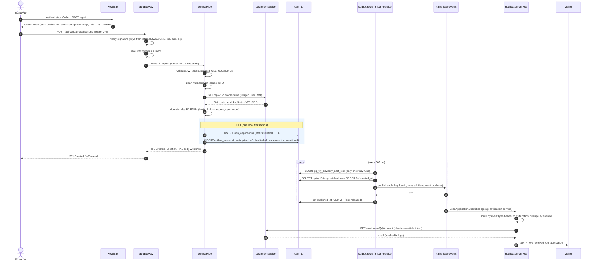
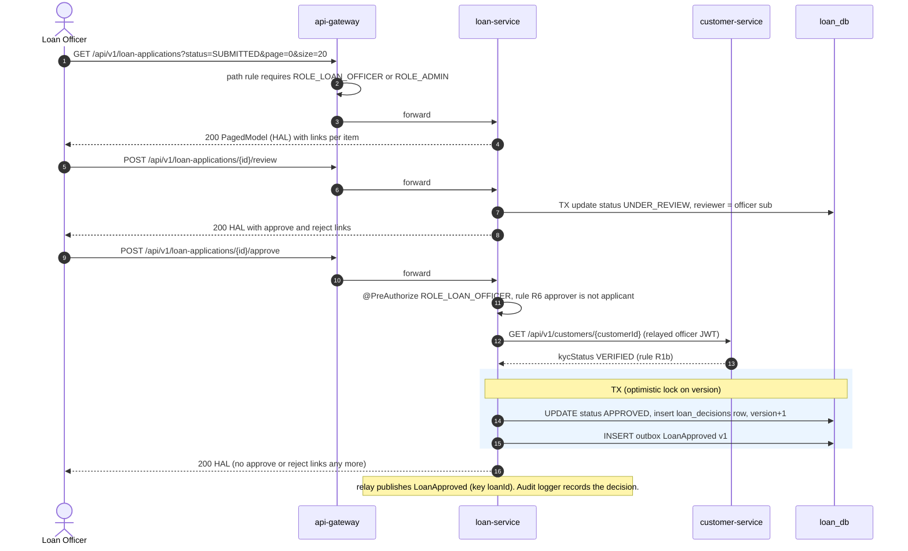
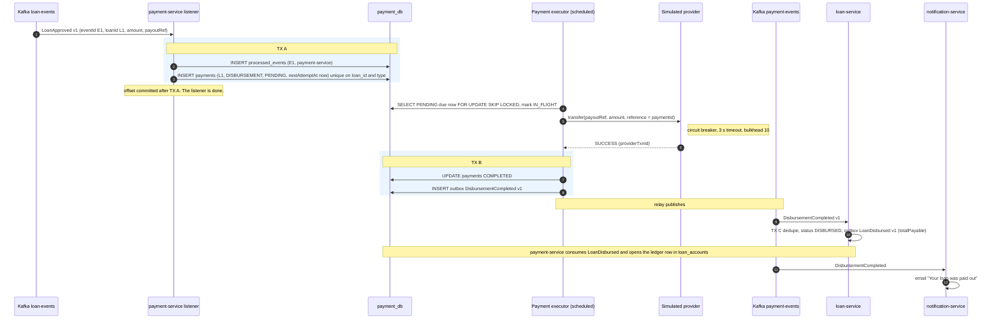
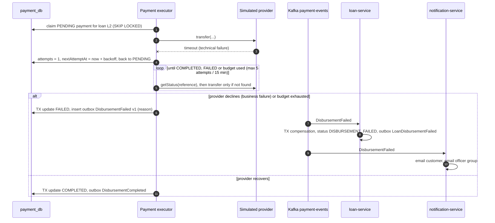
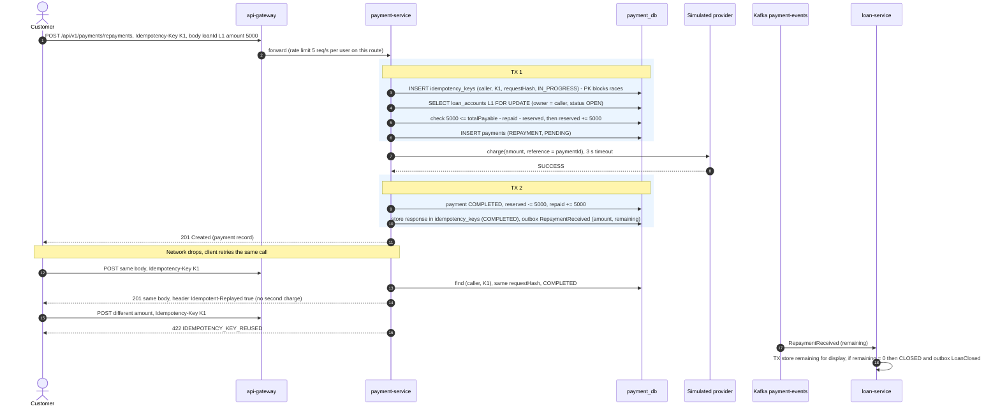
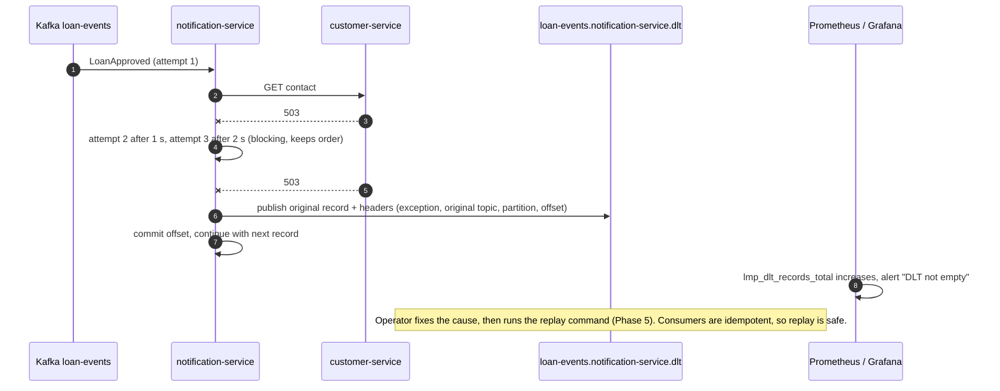
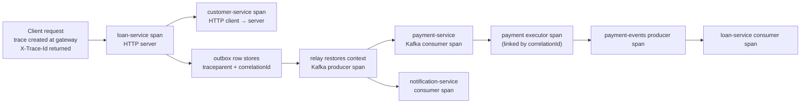

# 02 — Key Workflows and Failure Scenarios

Status: **Reviewed — final Phase 1 design** (revised after the [architecture review](08-architecture-review.md)). These diagrams are the target behaviour. Each phase's tests must prove them.

| # | Workflow | Required scenarios covered |
|---|---|---|
| W1 | Customer signs in and submits a loan application | 1, 2, 3, 4, 5 |
| W2 | Loan officer reviews and approves / rejects | 6 |
| W3 | Disbursement saga — happy path | 7, 8, 10 |
| W4 | Disbursement saga — failure and compensation | 7, 8, 9 |
| W5 | Repayment with an idempotency key and a locked ledger | 8 |
| W6 | Consumer failure → retries → dead-letter topic | 9, 10 |

Shared conventions in all diagrams:

- Every HTTP hop carries `Authorization: Bearer <JWT>` and W3C `traceparent`.
- Every Kafka record carries `eventType`, `eventVersion`, `traceparent` headers; the envelope carries `correlationId`.
- "TX" means one local database transaction. There is **no** distributed transaction anywhere.

---

## W1 — Sign in and submit a loan application

**What can go wrong**

| Step | Failure | Behaviour |
|---|---|---|
| 4 | Token expired / wrong issuer / wrong audience | Gateway returns `401` Problem Details. Request never reaches services |
| 5 | Too many requests | Gateway returns `429` with `X-RateLimit-*` headers |
| 9–10 | customer-service slow or down | 2 s timeout, 2 bounded retries, then circuit opens → `503 CUSTOMER_SERVICE_UNAVAILABLE`. Nothing is saved |
| 10 | KYC not verified | `422 KYC_NOT_VERIFIED`. Nothing is saved |
| 11 | Business rule fails | `422` with rule code, e.g. `EMI_EXCEEDS_INCOME_LIMIT` |
| 12–13 | DB error | Whole TX rolls back. No event exists. Client gets `500` with `traceId` |
| 18–19 | Kafka down | Relay stops the batch at the first failure (keeps order) and retries later. `lmp_outbox_lag_seconds` grows → alert. Application already saved; event goes out later |
| 21–25 | Notification fails | See W6. The loan flow is **not** blocked by email problems |

---

## W2 — Officer reviews and decides

| Failure | Behaviour |
|---|---|
| Two officers approve at the same time | One wins. The other gets `409 CONCURRENT_MODIFICATION` (JPA `@Version`) |
| Approve from wrong state (e.g. `SUBMITTED`) | `409 INVALID_STATE_TRANSITION` |
| KYC revoked since submission | `422 KYC_NOT_VERIFIED`; status stays `UNDER_REVIEW` |
| customer-service down during approve | `503 CUSTOMER_SERVICE_UNAVAILABLE`; no decision is stored (fail closed) |
| CUSTOMER token calls approve | Gateway `403`. If the gateway is bypassed, the service also returns `403` |
| Reject without reason | `400` validation error with field details |

---

## W3 — Disbursement saga (happy path)

Choreography saga. loan-service owns the loan status. payment-service owns the money movement. The Kafka listener never calls the provider; the **payment executor** does.

Why the provider call sits **between** two transactions and outside the listener: we never hold a DB transaction or a Kafka partition while waiting on a remote system. If the process crashes after TX A, the executor picks the payment up; if it crashes mid-call, `IN_FLIGHT` rows older than the call timeout return to `PENDING` and the executor first asks the provider for the status of our reference.

---

## W4 — Disbursement saga (failure and compensation)

- The provider is called with our `paymentId` as its idempotency reference. Asking again never pays twice.
- An open circuit is a **technical** failure: the payment stays `PENDING`; the executor tries again after the back-off.
- Demo triggers in the simulator (configurable): payout reference starting `SIM-DECLINE` → business decline; `SIM-SLOW` → latency above the timeout; random failure rate (default 0).
- **Compensation** here is a semantic undo: the approval cannot complete, so the loan moves to `DISBURSEMENT_FAILED` and people are told. No money moved, so nothing needs reversing.

---

## W5 — Repayment with an idempotency key and a locked ledger

| Case | Response |
|---|---|
| Missing `Idempotency-Key` | `400 IDEMPOTENCY_KEY_REQUIRED` |
| Ledger row not open yet (loan not disbursed) | `409 LOAN_NOT_OPEN_FOR_REPAYMENT` |
| Amount above remaining (minus reserved) | `422 AMOUNT_EXCEEDS_REMAINING` |
| Provider slow / circuit open | `202 Accepted`, payment `PENDING`; executor finishes; status via `GET /api/v1/payments/{id}` |
| Provider declines | `422 PAYMENT_DECLINED`; reserved amount released; payment `FAILED` |
| Same key while first call still running | `409 IDEMPOTENCY_REQUEST_IN_PROGRESS` |
| Same key, same request, finished | Stored response replayed, `Idempotent-Replayed: true` |
| Same key, different request | `422 IDEMPOTENCY_KEY_REUSED` |
| Key older than 24 h | Purged by a scheduled job. A new call is treated as new |

`requestHash` is SHA-256 of the canonical fields `loanId|amount|currency`, not of the raw JSON. Keys live in **PostgreSQL**, not in the cache, because they must survive restarts and be written in the same transaction as the payment.

---

## W6 — Consumer failure, retries and dead-letter topic

Rules:

- **Non-retryable errors** (bad JSON, unknown `eventVersion`, validation failure) go to the DLT at once.
- **Retryable errors** (timeouts, `5xx`, DB connection errors) get 3 attempts in total.
- Retries are **blocking** so per-loan ordering is kept ([ADR-0010](../adr/0010-spring-kafka-for-core-services-spring-cloud-stream-for-notifications.md)).
- Email sending is a side effect outside the DB transaction. A crash between "sent" and "commit" can send one duplicate email; the notification row (`PENDING → SENT`) and the `eventId` check keep that window small. Accepted and documented.

---

## Tracing across the whole workflow

One trace in Jaeger shows gateway → loan-service → customer-service → (outbox) → payment-service → loan-service → notification-service. The executor runs on its own schedule, so it starts a new span **linked** to the stored trace context; `correlationId` ties all logs together even when a trace was not sampled.

---

## Failure scenario catalogue

| # | Scenario | Detected by | System behaviour | Signal |
|---|---|---|---|---|
| F1 | customer-service down during submit or approve | timeout / circuit breaker | Fail fast `503`, nothing saved | `resilience4j_circuitbreaker_state`, error rate |
| F2 | Kafka down | producer errors in relay | Events wait in outbox, delivered later in order | `lmp_outbox_lag_seconds`, `lmp_outbox_pending` |
| F3 | Duplicate `LoanApproved` delivery | unique `processed_events` key + unique disbursement per loan | Second copy ignored | `lmp_duplicate_events_total` |
| F4 | Provider timeout | HTTP timeout / circuit breaker | Payment stays `PENDING`, executor retries within budget | `lmp_payments_total{outcome="pending"}` |
| F5 | Provider declines | provider response | Saga compensation → `DISBURSEMENT_FAILED` | `lmp_payments_total{outcome="failed"}` |
| F6 | Poison message | deserialization / validation | Straight to DLT | `lmp_dlt_records_total` + alert |
| F7 | Two officers decide at once | optimistic lock | One `409` | `lmp_concurrent_modification_total` |
| F8 | Client retries repayment | `Idempotency-Key` | Same response, no double charge | `lmp_idempotent_replays_total` |
| F9 | Two parallel repayments exceed remaining | ledger row lock + reserved amount | Second gets `422 AMOUNT_EXCEEDS_REMAINING` | `lmp_repayment_rejected_total` |
| F10 | Request flood | gateway rate limiter | `429` | gateway request metrics, count of `429` |
| F11 | Pod crash mid-payment | `IN_FLIGHT` older than timeout | Back to `PENDING`, status check first, then retry | executor metrics |
| F12 | Keycloak down | JWKS cached by resource servers | Existing tokens keep working until expiry. New sign-ins fail | Keycloak health, `401` rate |
| F13 | Config server down at startup | fail-fast config import | Service exits; Compose/Kubernetes restarts it until config is available | restart count, readiness |
